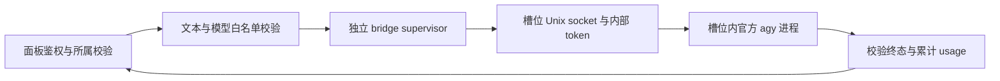

# Antigravity 实验接入

目前实现独立平台、面板 OAuth 绑定和官方 CLI 纯文本会话。文本功能默认关闭，仅支持本机 Docker 槽位；账号授权由槽位内官方 `agy` 完成。

## 支持范围

| 能力 | 当前状态 |
| --- | --- |
| 独立槽位、平台筛选、密钥分组、模型目录 | 已实现 |
| 面板纯文本会话、同进程续聊、显式关闭 | 已实现，实验功能 |
| 超时、断连取消、会话容量及空闲回收 | 已实现 |
| 逐轮 usage | 从官方累计计数计算差值；计数缺失时返回 null |
| 通用 `/v1/messages`、Chat Completions、Responses | 明确拒绝，不进入 Claude/GPT 账号池 |
| system、任意历史导入、图片、调用方工具 | 暂不支持；不会压成 prompt 静默转发 |
| OAuth 授权链接、回填授权码、取消与过期回收 | 已实现，官方 CLI 管理凭证 |
| 导入 token、配额及生产计费 | 暂未接入 |
| 远程节点、KVM | 暂不支持 |

模型使用 `antigravity/<官方模型 ID>` 命名空间。账号平台与模型厂商独立：即使模型由 Anthropic 提供，Antigravity 账号也不会进入 Claude 池。

## 部署步骤

1. 在控制台创建 Antigravity 槽位，绑定独立出口。默认保持停止。
2. 点击槽位的“绑定凭证”，选择“生成授权链接”。认证可在文本功能关闭时执行，会按需启动当前槽位，但不会启用聊天。
3. 主控镜像包含 SHA-512 校验并固定为 1.4.4 的官方 Linux amd64 CLI，首次认证将其放入槽位 `/home/kincli/.local/bin/agy`。默认 `cli_bin: "agy"` 即可；自定义路径时需自行准备兼容的官方 CLI。
4. 在本机浏览器打开生成的 Google 授权链接，完成授权，将页面给出的单行授权码粘贴回面板。官方 CLI 在同一槽位、同一出口内完成换票并保存凭证。已有有效会话可由官方客户端静默确认；取消不会注销原账号。
5. 在全局设置中启用实验文本功能，录入账号实际可用的官方模型 ID。模型清单来自本地配置，不会借用 Claude/GPT 目录。
6. 确保 bridge 可用的 Linux Node 运行时与槽位架构、系统库兼容。Linux 控制面默认使用 `process.execPath`；macOS 控制面或控制面与槽位架构不同的部署，必须设置 `KIN_ANTIGRAVITY_NODE_BIN`，指向匹配槽位架构的 Linux Node 可执行文件。该文件会复制进槽位，macOS 的 Node 不能直接使用。
7. 检查状态并发送首条文本。`authenticated: null` 表示尚未确认登录状态；bridge 健康不等于已通过官方认证。成功收到终态文本后再验证续聊、关闭与重启后的登录持久化。

bridge 在槽位内执行 `agy`，不会在控制面运行官方客户端。官方 1.4.4 在容器中使用自身的文件存储后端，凭证留在持久挂载的 `/home/kincli`。项目不读取或镜像 token，只保存 `authenticated` 和更新时间等展示元数据，不把 bridge 健康当成授权成功。

OAuth 会话按操作者、槽位和所属用户隔离，有效期 30 分钟。关闭弹窗、取消、槽位停止/删除、变更所属用户或主控正常退出会清理登录进程。授权码只转发至该次官方 CLI 的终端输入，不写入项目数据库或终端日志。Google 登录及授权需要账号持有人在浏览器完成。

配置保存于现有 routing 配置的独立字段：

```json
{
  "antigravity": {
    "enabled": false,
    "cli_bin": "/home/kincli/.local/bin/agy",
    "models": [
      {
        "id": "replace-with-official-model-id",
        "display_name": "账号实际可用的模型",
        "enabled": true
      }
    ],
    "max_sessions": 1,
    "idle_ttl_seconds": 600,
    "timeout_ms": 180000
  }
}
```

修改配置后重启相应槽位以应用 bridge 配置。关闭 `enabled` 会拒绝后续聊天请求，仍允许显式关闭旧会话；需要立即停止正在执行的请求时，应关闭会话或停止槽位。

## 面板接口

均沿用现有面板鉴权；普通用户只可操作自己的槽位，super 角色只读。

| 方法与路径 | 用途 |
| --- | --- |
| `GET /api/panel/vms/:id/antigravity/status` | 只读检查，不启动 CLI |
| `POST /api/panel/vms/:id/antigravity/oauth/start` | 创建授权会话，立即返回；准备过程通过轮询读取 |
| `GET /api/panel/vms/:id/antigravity/oauth/session?session_id=...` | 读取本人的授权链接与状态 |
| `POST /api/panel/vms/:id/antigravity/oauth/complete` | 提交 `{session_id,code}` 给官方客户端 |
| `POST /api/panel/vms/:id/antigravity/oauth/cancel` | 终止 `{session_id}`，保留已有凭证 |
| `POST /api/panel/vms/:id/antigravity/chat` | 发送 `{model,prompt,session_id}` |
| `POST /api/panel/vms/:id/antigravity/close` | 关闭 `{session_id}`，即使平台已禁用也可清理 |

成功响应沿用 `{ok:true,data:{...}}`，聊天数据包含 `text`、`session_id`、`usage`、`usage_cumulative` 和 `terminalState`。错误返回 HTTP 4xx/5xx 与 `{ok:false,error:{code,message}}`。

首次发送前生成并保留 `session_id`，续聊时原样发送；模型在会话内固定。会话按面板用户和槽位隔离，同一会话只允许一轮执行。请求失败后可以重试，或显式关闭后创建新会话；不能假定失败意味着旧进程已关闭。已回收的会话会返回 `antigravity_session_closed`，需关闭后换用新 ID。进程上下文不跨槽位/bridge 重启持久化，重启后应新建会话。

## 执行结构



每个会话持有一个 CLI 进程，使用官方 [stream-json headless 协议](https://antigravity.google/docs/cli/headless/)。bridge 创建专用无工具 agent，并在收到匹配 agent/model 且 `tools: []` 的 init 后才发送用户消息。遇到工具步骤、协议异常或缺失终态会失败，不将部分输出作为成功回复。上游 stdout/stderr 不作为登录凭证日志保存。

Claude 的凭证刷新、配额探测、计划测试、目录同步、遥测和 kernel 配置均跳过 Antigravity。数据库只镜像 Antigravity email 等展示元数据，秘密仍由官方客户端管理。

## 验证与后续

自动测试使用假的 CLI 子进程与真实本地 Unix socket，覆盖事件解析、续聊、累计计数差值、并发互斥、空闲回收、取消、终态缺失、工具拒绝、面板租户权限及原生池隔离。它们不替代真实客户端验收。

真实账号的换票、重启持久化及推理验收仍需账号持有人完成浏览器授权后验证。后续再评估完整历史、system、多模态和工具回传所需的数据面；通过能力验证后才开放通用 API、自动调度与计费。
