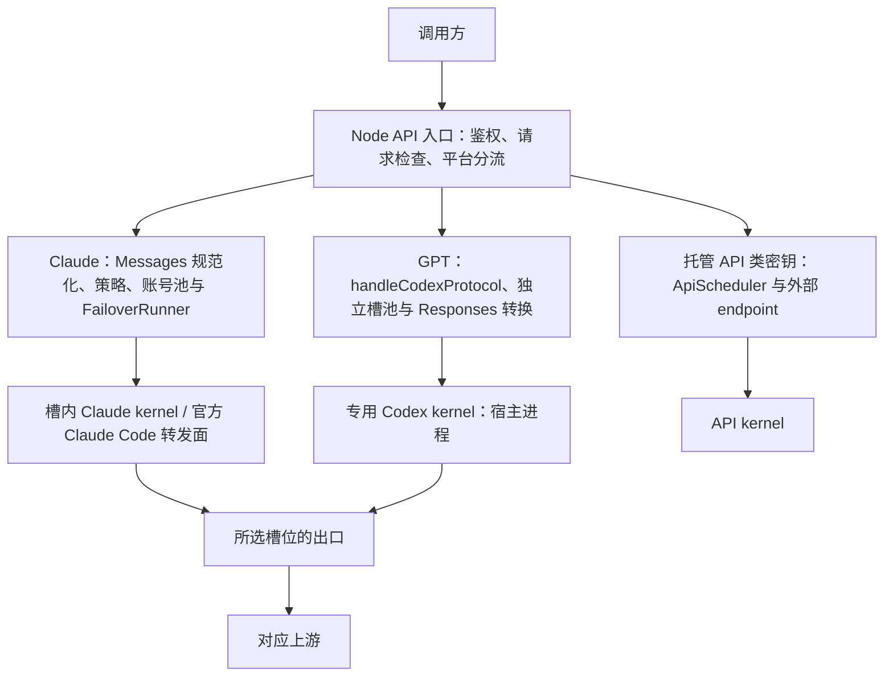
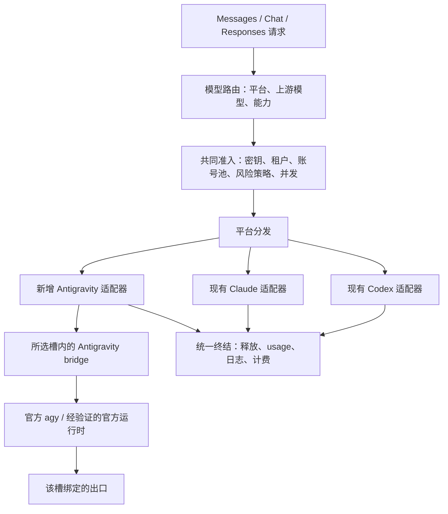

# Antigravity 平台架构分析与实施方案

分析日期：2026-10-21。代码基线：`eee8f6ec`。本文件记录实施前的静态分析与方案。随后已实施平台基础及实验文本会话，当前能力与部署步骤见 [ANTIGRAVITY.md](ANTIGRAVITY.md)；真实账号和上游请求尚未验证。

建议将 Google Antigravity 作为第三种独立账号平台，复用 vm2api 的控制面、槽位隔离和出口管理，新增专用的数据面 bridge。先验证官方 CLI 的订阅登录和文本会话，再决定完整 API 兼容的数据面实现。当前官方 CLI 文本接口尚不足以证明能达到现有产品要求的零注入、完整历史、多模态及客户端工具调用兼容。

## 1. 当前项目的实际架构

### 1.1 控制面与数据面

项目是 Node.js ESM 控制面、React 管理台与独立推理进程的组合。`worker/` 和 `api-kernel/` 包含 Go 组件，核心 Claude/Codex 推理 kernel 则通过 `deploy/payload.json` 引入预编译文件；当前仓库没有可直接扩展的 Antigravity kernel。

图中的 API endpoint 是另一种推理 backend；其入口顺序和协议限制仍受现有 handler 约束，不能据此认为它已经是任意平台插件系统。

`src/server.mjs` 顶部及部分文件注释还保留 Go 推理转发描述。判断现状应以 `slot-engine.mjs`、`slot-runtime.mjs` 和实际 transport 调用为准。

### 1.2 Claude 路径

1. `src/lib/protocol/handle-protocol.mjs` 接收协议请求，检查模型、密钥范围、拦截策略，并转成 Anthropic Messages。
2. `src/lib/pool/pool-scheduler.mjs`、`seat-planner.mjs`、`account-quota.mjs` 管理候选账号、会话座位、并发与配额；`failover-runner.mjs` 控制重试和换号。
3. `src/lib/vm/slot-engine.mjs:129` 对 Claude 解析 Rust 引擎；同文件将 Rust 对应的 official CC inference 固定为 cli-hop。
4. `src/lib/vm/slot-runtime.mjs` 和 Rust kernel supervisor 管理槽内推理进程；Claude Code 转发、CONNECT 和绑定出口承担上游访问。
5. 控制面转换流式/非流式结果，处理日志、usage、计价及托管密钥使用量。

这一路径可复用的是生命周期、调度和结果处理思路。Claude 原生 Messages、beta headers、Setup Token、Console、初装及遥测均属于平台特定能力。

### 1.3 GPT 路径

1. `platform-detect.mjs` 将 GPT 系列识别为 `openai`。
2. `handle-protocol.mjs:733` 提前进入 `handleCodexProtocol()`；OpenAI 协议在该分支转换或保留为 Responses。
3. `handle-codex.mjs:207` 的候选选择与 `codex-slot-pool.mjs` 独立管理 GPT 槽、额度、粘性和重试。
4. `codex-kernel-client.mjs` 通过 Unix socket 和内部 token 调用 `/internal/v1/codex/responses`。
5. `codex-kernel-supervisor.mjs` 在宿主侧管理专用 kernel；`vm-runtime.mjs:188` 中 GPT 容器的命令是 `sleep infinity`，容器承担身份、网络和运维环境。
6. GPT 凭证独立存于 `vms/<id>/codex-credentials.json`，模型目录和配额也有专用实现。

公开 Node 代码证明了专用 kernel 的调用边界；仅凭这些代码不能确认 kernel 内部与 Claude 使用完全相同的官方客户端进程模式。

### 1.4 值得保留的公共基础

| 能力 | 当前实现 | 接入时的使用方式 |
|---|---|---|
| HTTP、鉴权、协议入口 | `src/server.mjs`、`src/lib/http/`、`handle-protocol.mjs` | 保留入口，平台分流前建立共同准入流程 |
| 槽位与远端位置 | `src/lib/vm/`、`src/lib/cluster/`、`slot-host.mjs` | 复用 placement、独立 home、出口和远端执行抽象 |
| 会话与并发 | `sticky-router.mjs`、`session-limit.mjs`、`seat-planner.mjs` | 复用机制，扩平台命名空间和容量策略 |
| 故障处理 | `failover-runner.mjs`、上游错误策略 | 复用原则，增加 Antigravity 终态及错误分类 |
| 数据与管理台 | SQLite repos、panel API、`web/src/features/vm/` | 扩展元数据、平台能力和展示 |

## 2. 第三平台会碰到的具体约束

| 位置 | 当前行为 | Antigravity 所需改动 |
|---|---|---|
| `src/lib/vm/vm-kind.mjs:27` | Claude/Codex 两类；未识别记录回落 Claude | 显式第三平台优先；未知显式平台拒绝；仅无标记旧记录保留兼容回落 |
| `src/lib/vm/vm-kind.mjs:56` | stamp 只清理或创建 Claude/Codex 字段 | 增第三分支并清理冲突平台字段 |
| `src/lib/protocol/platform-detect.mjs:6` | 先取 model 路径最后一段，再按 GPT/Claude 前缀判断 | 先解析平台命名空间，保留平台信息 |
| `src/lib/protocol/handle-protocol.mjs:733` | OpenAI 独立返回，其余继续 Claude 流程 | 增 Antigravity handler；Claude warmup、persona、模型检查仅用于 Claude |
| `src/lib/pool/schedule-eligibility.mjs` | Claude gate 显式排除 Codex | 按明确的平台资格筛选，防止第三平台混入 Claude 池 |
| `src/lib/vm/slot-engine.mjs:129` | 非 Codex 默认 Rust/Claude | Claude 配置只对 Claude 生效，AG 使用自己的 runtime |
| `src/lib/vm/vm-runtime.mjs:188` | 非 Codex 容器启动 Claude kernel | 按平台生成启动命令和挂载 |
| `src/lib/vm/slot-runtime.mjs:107` | GPT 特例，其余走 Claude 凭证与 kernel | 扩启动、停止、健康、恢复和升级分支 |
| `src/lib/vm/vm-registry.mjs` | 摘要与可调度凭证多处 Claude/Codex 二分 | provider 专用 credential summary 与 schedulability |
| `src/lib/admin/key-scope.mjs:17` | 非 Codex 视为 anthropic | 新增 antigravity 范围，统一候选权限过滤 |
| `src/lib/pool/sticky-router.mjs:30` | 仅识别 anthropic/openai 平台前缀 | 增 antigravity，防跨平台共享会话记录 |
| `src/lib/protocol/models.mjs:66` | 本地 Claude/GPT 目录二分 | 增平台目录及可见性过滤；GET 不触发上游同步 |
| `src/lib/admin/catalog-monitor.mjs` | 两套目录与同步状态 | 新增独立探测与缓存，不让 AG 进入 Claude 后台探测 |
| `src/lib/db/repos/vms-repo.mjs:47` | 专门清理 `vm.claude` 的秘密字段 | 通用凭证脱敏；AG 元数据不携带登录秘密 |

一个直接的路由问题：当前 `antigravity/claude-…` 会先丢掉 `antigravity/`，继而被识别为 Anthropic。因此不能仅增加 Gemini 正则或管理台平台选项。

后台监控也要同步扩展：凭证刷新、配额探测、健康测试、catalog、kernel watchdog、自动恢复和遥测，均须按平台能力调用，避免新增槽位触发 Claude 初始化或错误刷新。

## 3. Antigravity 官方能力与可行性边界

核查日期同本报告。以下是文档证据，尚未在本项目部署环境实测。

官方 CLI 提供 `agy --input-format stream-json --output-format stream-json`，同进程保留多轮会话；输出包含 `init`、`step_update`、`result`。输入仅支持用户文本或 text blocks，不支持控制请求、控制响应及其他 block。每轮应等待 result 后再提交下一轮；result 的 usage 是会话累计值。来源：[Headless mode](https://antigravity.google/docs/cli/headless/)。

CLI 支持 Google 账号登录及远程授权码流程，认证使用系统 keyring；SDK 文档列出的编程认证方式包括 Gemini API key、Enterprise/Vertex 及本地模型，尚未确认 SDK 对个人 Antigravity 订阅 OAuth 的支持。来源：[Authenticate](https://antigravity.google/docs/install)、[SDK overview](https://antigravity.google/docs/sdk/overview)。

SDK 支持自定义 system instructions、工具及内置工具过滤，但 SDK 内执行 Python 工具，并不能直接证明支持 API 调用方接收 tool call、下轮再回填 result 的交互。来源：[Personas](https://antigravity.google/docs/sdk/personas/)、[Tools and skills](https://antigravity.google/docs/sdk/tools/)。

Antigravity 提供按模型查看配额的能力，另有 credits 消费设置。应独立描述其额度策略，不能直接套用 Claude 的 5h/7d 字段。来源：[Model quotas](https://antigravity.google/docs/cli/commands/usage)、[CLI AI credits](https://antigravity.google/docs/cli/credits)。

| 路线 | 适用目标 | 决策 |
|---|---|---|
| 官方 CLI + 槽内 bridge | 验证订阅登录、出口、文本流式、持久会话 | 首个技术验证方向 |
| 官方 SDK | 自定义 agent、system、工具，且认证路径符合产品目标 | 单独验证订阅认证；API key/Vertex 需清楚标明 backend |
| 官方运行时的底层协议适配 | 完整历史、图片、外部工具及更精确的请求控制 | 需要实际运行时证据与协议实验，当前不预设接口、凭证格式或可行性 |

首个文本验证宜通过管理台测试对话或明确的实验会话接口进行，采用单条用户文本及显式 session 绑定。普通 Chat/Messages 客户端会发送完整历史，CLI 输入文档并未提供任意角色历史替换接口；把历史、system 或工具 schema 拼成一段 prompt 会改变协议语义。完整 API 版本必须另行解决这一点。

还需验证 CLI 内置工具与默认提示词：现项目要求工具在调用方执行，而 CLI 是 agent runtime。只有证明可以正确约束内置工具并控制所需指令后，才适合开放相应 API 能力。

## 4. 推荐目标架构

初期在现有结构中加薄注册层与独立 AG 模块，保留 Claude/Codex 文件位置。逐步抽取共同准入及终结，避免一次重写全部协议转换和调度。

### 4.1 分开四种身份

| 字段 | 示例 | 用途 |
|---|---|---|
| account platform | `anthropic` / `openai` / `antigravity` | 凭证、出口、调度、权限和日志归属 |
| model vendor | `anthropic` / `openai` / `google` 等 | 模型厂商信息与徽标 |
| upstream model | 对应账号目录实际返回的 ID | 向上游发送的模型 |
| inbound protocol | `anthropic.messages` / `openai.chat` / `openai.responses` | 请求和响应编码 |

经 Antigravity 访问的 Claude 模型，其 account platform 为 antigravity，vendor 仍可为 anthropic。厂商信息不能参与账号平台权限判定。

对外建议使用 `antigravity/<upstream-model-id>`。保留已有 Claude/GPT 裸 ID 规则；Gemini 裸 ID 仅在管理员明确建立映射后启用。解析命名空间与映射时，先保存平台，再进行平台内部模型校验，未知组合拒绝。

路由记录建议包含 `public_model`、`platform`、`vendor`、`upstream_model`、`capabilities`。模型映射不能通过改名绕过密钥平台范围；master 的指定槽位也必须在路由和权限确定后检查平台一致性。

### 4.2 平台注册表与能力

平台描述至少覆盖：身份归一化、凭证摘要、协议能力、模型目录、runtime 生命周期、健康状态、配额解释、候选资格及错误分类。各平台保持专用转换器和数据面。

能力按“平台 + 已验证 runtime 版本 + 模型”表达，例如文本流、图片、system、外部工具、结构化输出、历史导入、会话恢复、quota probe。未验证的能力标为不支持，并在请求入槽前返回明确错误。

### 4.3 独立 bridge 契约

建议 bridge 在选中槽位内运行，以受保护 Unix socket 和内部 token 接收控制面请求，沿用现有跨节点 relay 思路。下列名称是新设计，不是上游官方接口：

- `health` / `capabilities`：版本、登录状态和已验证能力。
- `models` / `quota`：读取缓存或执行受控探测。
- `infer`：携带 request、session、model 和已校验输入，返回结构化事件。
- `cancel` / `close-session`：显式终止及回收。

初期可用 Node bridge 驱动官方 CLI，无须先制造第三个 Rust kernel。实现语言和现有封闭 kernel 保持解耦；进程所在位置、协议与出口约束才是关键。

事件至少区分 text delta、usage observation、成功终态、失败及取消。未来工具调用事件应独立于 CLI 内部工具执行日志。

### 4.4 登录、存储与隔离

一个槽位绑定一个账号和一条出口；认证操作、刷新、模型探测、配额探测、推理均从该槽所在节点的绑定出口发出。出口或远端链路失效时返回失败。

CLI 登录优先复用现有终端登录交互。除了独立 HOME，还要验证 Linux keyring、DBus/Secret Service、凭证持久化及重启后的隔离；不能把共享系统 keyring 视为独立账号存储。刷新由官方进程拥有，控制面读取摘要，避免双重刷新竞争。

`vm.json` 和数据库镜像仅保存平台、账号标识、凭证存在标记、过期信息与 runtime 元数据。秘密存储方式以官方认证机制实测为准，不预设可导出 access/refresh token。清理、备份、迁移和日志脱敏均需覆盖该存储。

当前 `vms.vm_json` 能承载平台元数据，`api_keys.group_type` 是 TEXT；仅新增平台枚举本身不必做 SQL 迁移。若增加可索引的日志平台、配额快照或计费维度，再添加有目的的迁移。

### 4.5 会话、流和故障处理

sticky 身份应隔离租户、密钥范围和平台，并绑定 account、vm、conversation；同一 CLI conversation 的请求串行化，不同会话的进程容量单独管理。账号切换、模型切换或 runtime 重启后的上下文恢复，均以真实能力决定。

客户端发送完整历史时，需要校验它与槽内会话的一致性，并定义分叉、编辑历史和重放规则。禁止向已经保存历史的 CLI 每轮重复喂入整段历史；也不能只取最后一条消息而静默丢失其余内容。

成功、输出提交、usage 观测是三个独立状态。收到成功终态且结构完整，才能标记完成；已输出文本或已有 token 计量不足以证明成功。SSE 心跳单独管理 HTTP 状态是否还能改变，业务输出开始后不再透明换号。

CLI 流按 step 和 conversation 解析 text delta，最终全文仅用于校验或非流式组装，避免重复拼接。重试必须同时满足可重放、尚未提交业务输出且没有不可重放副作用；会话留在原槽与跨账号换槽分别判断。

取消和超时需要向官方进程传播并回收 lease；若未证明取消后会话仍可安全继续，则关闭该会话并返回明确的恢复状态。

### 4.6 配额和计费

使用独立 Antigravity quota 模型，保存模型或额度组、剩余比例/数量、重置时间、探测来源和快照时间。缺少数据时展示未知，quota probe 与推理会话分开执行。

CLI 累计 usage 按会话 epoch、请求边界和所有可信终态快照计算增量，包含失败、取消及中断时的有效观测，成功状态另外判断。恢复会话需同步恢复基线；终态缺失、计数倒退或基线不可靠时保留未知区间，不把累计差额归到后续请求。step usage 可用于排查，不与 result 重复相加。

区分平台实际 credits、模型 token 数和本系统托管密钥计价。经 AG 访问 Claude 的实际成本不能直接等同于 Anthropic API 公开价格；管理员价格规则需标明计价来源。未知价格和未知 usage 均显式记录。

## 5. 现有公共流程需要专项回归的地方

静态阅读发现 Claude/GPT 的共同约束分布不一致，新增平台应先抽取或明确复用入口，不能照抄其中一个完整 handler。

- Claude 在 `handle-protocol.mjs:1196` 传入 owner scope，scheduler 过滤所有者；GPT 候选主要使用 `keyAllowsVm()`。应测试 master、租户、all key、限定平台及动态账号池的组合，确认实际候选始终满足权限交集。
- GPT 在 `handle-protocol.mjs:733` 提前返回；同文件可见托管密钥 acquire 和计费写入位于后面的 Claude/API 分支。应专项确认 key RPM、并发、usage 扣减和 finally 释放的一致性。
- GPT handler 存在依据 usage 判断已交付结果的逻辑。AG 应实现显式成功终态校验，分别记录 `output_committed`、`completion_verified` 和 `usage_observed`。

这些是静态调用链上的验证点，本次没有把它们作为已复现运行时故障。

## 6. 文件级实施范围

| 模块 | 现有改动位置 / 建议新增位置 |
|---|---|
| 平台与路由 | 修改 `vm-kind.mjs`、`platform-detect.mjs`、`handle-protocol.mjs`；新增 `src/lib/platforms/registry.mjs`、`protocol/model-route.mjs`、`protocol/handle-antigravity.mjs` |
| 调度与权限 | 修改 `key-scope.mjs`、`resource-owner.mjs` 的使用位置、`sticky-router.mjs`、资格 gate；新增 `pool/antigravity-slot-pool.mjs` |
| 数据面 | 新增 `transport/antigravity-bridge-client.mjs`、`transport/antigravity-bridge-supervisor.mjs` 与独立 bridge 入口 |
| 生命周期 | 修改 `slot-runtime.mjs`、`vm-runtime.mjs`、`slot-host.mjs`、registry 摘要及恢复/watchdog；新增 AG slot 元数据模块 |
| 凭证与探测 | 新增平台专用 auth 状态与 catalog/quota probe；扩 refresh monitor、catalog monitor、测试对话的分发 |
| 数据与计费 | 扩 `vms-repo.mjs` 脱敏、request log、pricing/catalog、统计和备份；必要时做日志维度迁移 |
| 创建与账号页 | 修改 `web/src/lib/vm-kind.ts`、`cred-type.ts`、`features/vm/create-vm-form.tsx`、账号/运维 tab；新增 AG 凭证面板 |
| 模型与权限 UI | 修改 models、allowed-models、key-payload、key-limits、相关 panel types；model vendor 图标继续独立使用 |
| 配额与统计 UI | 扩 scheduling、usage-windows、VM table、overview、billing；日志优先显示实际路由平台 |
| 部署 | 扩 `deploy/payload.json` 或镜像构建、版本校验、依赖、keyring 持久化、健康检查和升级策略 |

以上新增文件均为建议，当前尚不存在实现。首期支持的 host/runtime 组合必须显式声明；未实现的 KVM、远端或 native-node 组合直接拒绝创建或启动。

## 7. 建议实施顺序与验收

| 阶段 | 交付 | 通过条件 |
|---|---|---|
| P0：真实客户端验证 | 固定 CLI 版本、测试记录、能力表、脱敏事件样本 | 隔离登录、出口、重启、文本流、多轮、取消及 usage 明确；记录 system/工具/历史/图片缺口 |
| P1：第三平台基础 | registry、命名空间、key/owner 范围、runtime 隔离和公共终结流程 | AG 不进入 Claude/Codex 池；旧路由与密钥行为回归通过；功能默认关闭 |
| P2：受限文本验证版本 | 槽内 bridge、明确请求限制、模型缓存、测试对话 | 限定文本请求流/非流可用；不支持形状入槽前拒绝；不承诺完整 API 等价 |
| P3：完整协议兼容 | 经验证的数据面、历史/system、客户端工具、图片、各协议转换 | 每项能力有真实验收证据；若官方接口不满足，则保留受限能力并记录阻塞原因 |
| P4：运维上线 | 多槽调度、配额、统计、备份、远端、升级和回滚 | 多账号隔离与故障演练通过；面板显示和实际调度一致 |

P0 是决定完整接入路线的技术关口。若官方 CLI 的控制面限制无法满足产品目标，P3 应先取得 SDK 订阅认证或官方运行时协议的可行性证据，随后再实现完整兼容。

必要验证包括：

1. 平台命名空间保留，AG 的 Claude 模型不会选 Anthropic 槽；未知模型不发上游。
2. 密钥平台、VM allowlist、动态账号池与租户范围取交集；指定槽位不绕过限制。
3. 独立凭证存储与 keyring，vm/DB/日志无秘密泄露；换账号后旧进程和会话退出。
4. 所有外部操作从正确节点出口发起；代理断开或远端失联时不改变出口。
5. 同会话串行、不同会话隔离，历史分叉/编辑/恢复符合约定，容量耗尽时正确排队或拒绝。
6. Unicode/半包/多行 JSON、ACTIVE/DONE、终态丢失、进程崩溃、背压和客户端断连均正确处理。
7. 首次输出后不换号；usage 缺失、累计计数、重复事件和恢复基线不会造成错误计费。
8. 不支持的 system、图片、外部工具或 Responses 功能明确拒绝；通过兼容验收后才逐项开放。
9. 现有 Claude/GPT 的协议、计费、配额、槽位生命周期和管理台行为无回归。

可复用现有 Node unit/e2e 框架；协议状态机使用脱敏真实事件 fixtures；官方 CLI 登录、出口和多账号隔离使用独立的真实环境验收。本次仅完成分析，没有运行这些未来实现的测试。
